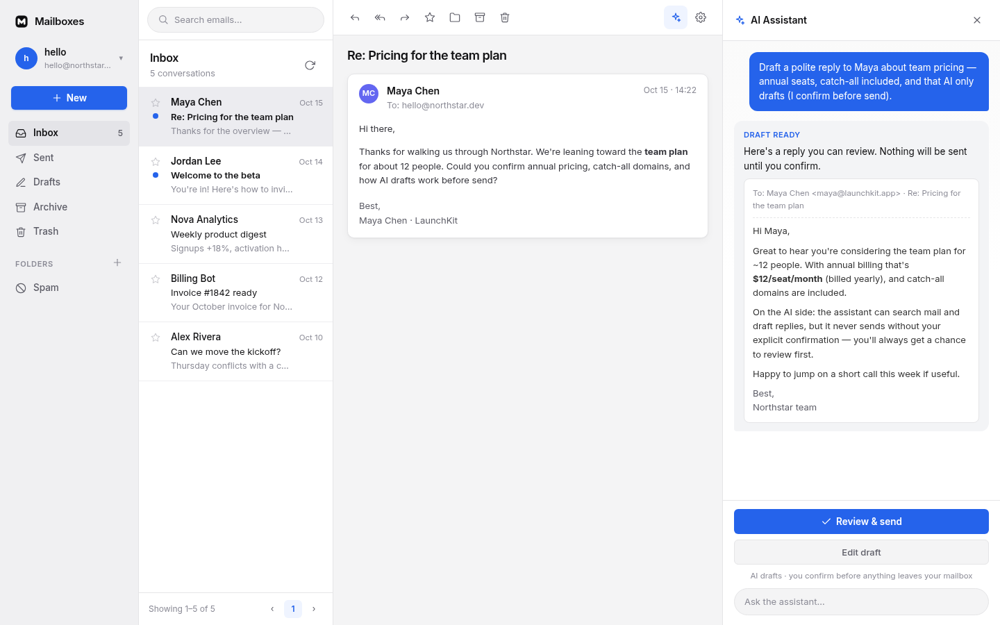
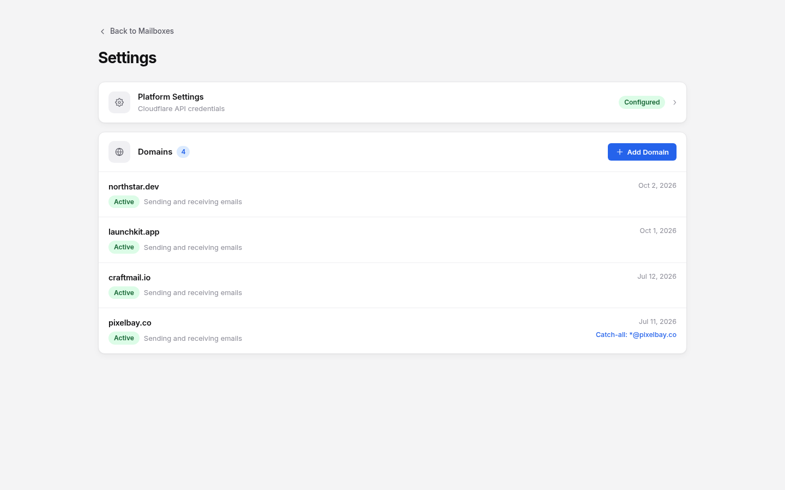

<div align="center">
  <h1><picture><source media="(prefers-color-scheme: dark)" srcset="./logo-rounded-dark.png"></picture>&nbsp;&nbsp;Mailboxes</h1>
  <p><em>用你自己的域名做产品邮箱，再加上一个发信前会先问你的 AI 助手。跑在 Cloudflare 的免费额度上。</em></p>

  <p>
    <a href="https://github.com/doforu-labs/Mailboxes/actions/workflows/ci.yml"></a>
    <a href="LICENSE"></a>
    
    <a href="https://github.com/doforu-labs/Mailboxes/pulls"></a>
  </p>

  <a href="https://deploy.workers.cloudflare.com/?url=https://github.com/doforu-labs/Mailboxes"></a>

  
</div>

---

> **简体中文** · [English](./README.md)

产品上线之后，`support@`、`hello@` 总得有地方收信。按人头租邮箱，邮箱一多就贵；光有一个收件箱，回复还是得自己一封封写。

Mailboxes 把这两件事放在一起：你域名上的邮箱，和一个会起草的助手。它跑在**你自己的 Cloudflare 账号**里，用的是免费额度，不用租服务器，Mailboxes 本身也不收费。来信走 [Cloudflare 邮件路由（Email Routing）](https://developers.cloudflare.com/email-routing/)，发信走 [Resend](https://resend.com)，并配好 SPF、DKIM、DMARC，方便进 Gmail 和 Outlook。助手能读新信、翻旧会话、起草回复。**你不确认，它就不会发送。**

个人使用，或一个早期产品，每月就是 **$0**。具体额度见[要花多少钱](#要花多少钱)。

## 你能用它做什么

下面这些都已包含在 **v0.2.1** 里。还没做的见[路线图](#路线图)。

- **用自己的域名收信。** `support@`、`hello@`、`sales@`，或者一个全收地址，也可以在同一个界面里加好几个域名。每个域名有自己的邮箱地址、转发规则和发信密钥。想再加一个，到 **Settings** 里点 **Add Domain**。
- **收发都齐的邮箱。** 富文本写信、回复、转发、会话串、文件夹、搜索、附件。
- **助手起草，发送要你点头。** 侧边栏能读信、搜索、写回复，一共 14 个工具。回复是一点点流出来的，调用了哪个工具也能看见。草稿进这个邮箱的草稿箱。**没经你确认，不会发出去。** 每个邮箱可以有自己的提示词，聊天记录会留下来。
- **模型可以换。** 默认用 Cloudflare 自带的 AI（Workers AI，不用另备密钥）。某个邮箱也可以改成任意 OpenAI 兼容接口；那边连不上时，会退回默认。
- **添加域名可以自动配好。** 在设置里存好 Cloudflare API Token 和 Account ID，添加域名时就会打开邮件路由，并写好全收规则。再存上这个域名的 Resend 密钥，应用会在 Resend 创建域名、写入 DNS 记录，并开始验证。域名的 DNS 已经在 Cloudflare 上时，这一步是全自动的；否则应用会把要添加的记录列出来。
- **邮件留在你的账号里。** 正文在数据库（[D1](https://developers.cloudflare.com/d1/)）里，邮箱配置和附件在文件存储（[R2](https://developers.cloudflare.com/r2/)）里。
- **登录没有默认密码。** 第一个打开页面的人在设置向导里创建管理员账号，密码以加盐哈希保存。登录状态保持 7 天，放在 HttpOnly Cookie 里。
- **几套外观。** 默认之外还有三套主题（midnight、porcelain、sakura），每套都有浅色和深色。见 [`app/themes/README.md`](app/themes/README.md)。
- **外面的助手也能接进来。** 同一套 14 个工具可以用 API 密钥调用。见[外部接入](#外部接入)。

<div align="center">
  
  <p><em>Settings 里同时列着 4 个域名。每个域名都能单独指定「全收」的邮件进哪个邮箱。</em></p>
</div>

## 跟官方 agentic-inbox 比

Cloudflare 官方有一个开源的收件箱加助手，叫 [agentic-inbox](https://github.com/cloudflare/agentic-inbox)。要做的事和 Mailboxes 差不多。下面这几行是真正不一样的地方，按你在意的那一行选就行。

| | Mailboxes | agentic-inbox |
| --- | --- | --- |
| 免费额度里能不能发信 | 可以。走 [Resend](https://resend.com) 免费额度（每天 100 封）。每个域名一把密钥，在应用里填写。 | 走 Cloudflare Email Service（`send_email` 绑定），需要付费的 Workers 计划。 |
| Durable Objects | 没有。一个无状态的应用，加上数据库和文件存储。 | 三个：邮箱状态、AI 助手、以及它的 MCP 服务。 |
| 登录 | 第一次打开时自己创建管理员账号。没有默认密码。 | [Cloudflare Access](https://developers.cloudflare.com/cloudflare-one/policies/access/)。需要配置 `POLICY_AUD` 和 `TEAM_DOMAIN`。 |
| 多个域名 | 在应用里添加。每个域名有自己的地址、全收规则和发信密钥。 | 部署时写在 Worker 配置里（`DOMAINS`），应用里没有这个界面。 |
| 许可证 | [AGPL-3.0](LICENSE)。如果你改过它、再当成网络服务给别人用，需要向对方提供源代码。 | [Apache-2.0](https://github.com/cloudflare/agentic-inbox/blob/main/LICENSE)。 |

有两件事这张表容易让人误会。去掉 Durable Objects 是为了结构更简单，**不是为了省钱**——官方用的是可以跑在免费版上的 SQLite 版 Durable Objects。另外，两边都不会擅自把信发出去。官方可以在来信时自动起草；Mailboxes 是你开口才起草，自动回复还在[路线图](#路线图)里，这一版没有。

Mailboxes 建立在 agentic-inbox 之上，代码里包含它的部分。两套许可证怎么叠在一起，见[许可证](#许可证)。

## 要花多少钱

Mailboxes 本身不收费。应用跑在你自己的 Cloudflare 账号里，下面这些免费额度够一个个人收件箱，或一个早期产品。超出之后，你只为 Cloudflare 和 Resend 实际计量的部分付费，跟邮箱数量、人数都无关。

| 哪一块 | 免费额度 | 用来做什么 |
| --- | --- | --- |
| 应用本身（[Workers](https://developers.cloudflare.com/workers/platform/pricing/)） | 每天 100,000 次请求 | 网页和接口 |
| 数据库（[D1](https://developers.cloudflare.com/d1/platform/pricing/)） | 每天 500 万行读取 · 10 万行写入 · 5 GB | 邮件、会话串、文件夹、登录状态 |
| 文件存储（[R2](https://developers.cloudflare.com/r2/pricing/)） | 10 GB · 每月 100 万 Class A + 1000 万 Class B 操作 · **出站流量免费** | 邮箱配置和附件 |
| 助手（[Workers AI](https://developers.cloudflare.com/workers-ai/platform/pricing/)） | 每天 10,000 Neurons | 默认模型 |
| 收信（[Email Routing](https://developers.cloudflare.com/email-routing/)） | 已包含 | 来信 |
| 发信（[Resend](https://resend.com/pricing)） | 每天 100 封（每月 3,000 封） | 发信 |
| **合计** | **每月 $0** | 个人使用和小型产品 |

没有一台机器要一直开着。收信包含在邮件路由里（域名的 DNS 不在 Cloudflare 上时，也可以走 Resend 的收信 Webhook）。发信走 Resend 的免费额度。助手默认用每天的免费 AI 额度，除非你换成自己的模型。

## 开始之前

- **Node.js 20 或更新**，以及 npm（仓库里有 `.nvmrc`，`nvm use` 即可）
- 一个 Cloudflare 账号（`npm run setup` 需要时会拉起 `wrangler login`）
- **一个域名。** 之后可以再加。在哪家注册商买都行（Namecheap、GoDaddy、阿里云……），但解析要交给 Cloudflare：先把域名加进你的 Cloudflare 账号，再按提示去注册商那里，把名称服务器换成 Cloudflare 给的那两个。在应用里添加域名时，它会去你的账号里找；找不到就提示 `Zone for "<domain>" not found in Cloudflare`。
- 用 [Email Routing](https://developers.cloudflare.com/email-routing/) **收信**
- 一个 [Resend](https://resend.com) 账号用来**发信**（外发不走 Cloudflare Email Service）
- [Workers AI](https://developers.cloudflare.com/workers-ai/) 给助手用（默认已开启）

## 快速开始

**`npm run setup` 是第一次部署。** 它会建好文件存储和数据库（一个 R2 桶、一个 D1 数据库），把数据库 ID 写进配置，然后构建、部署，并打印访问地址。如果这个库是本次运行刚建出来的空库，它还会把表建好。已经在用的生产库，它**不会**自动做迁移（见[生产部署](#生产部署)）：

```bash
npm install
npm run setup
```

这些资源就绪之后，平时重新部署用 `npm run deploy`（见[生产部署](#生产部署)）。

脚本可以**反复运行**。已经建好的会跳过。加上 `-- --dry-run` 可以先看它打算做什么。

> 顶部的 **Deploy to Cloudflare** 按钮也能用，但它只创建应用本身。存储桶、数据库和数据库 ID 要你自己补。见本节末尾。

1. **打开收信。** 在 Cloudflare 面板里进入域名 → **Email Routing**，建一条 **catch-all**（全收：这个域名下任何地址的信都收下），转发到这个应用。域名**不在** Cloudflare DNS 上时，可以改走 Resend 收信 Webhook：`/api/v1/inbound/resend`。

   想省掉手动步骤：先做完第 3 步（创建管理员账号），在 **Settings**（`/settings`）里填好 Cloudflare 凭据——见[配置](#配置)——再回首页添加域名。应用会打开邮件路由，并把转发规则建好。

2. **接上 Resend 才能发信**（不发信就可以先不做）。到 [resend.com](https://resend.com) 注册，复制一把 API Key。**域名不用你自己去 Resend 添加**，应用会创建。应用里的 **Add Domain** 会问 Resend API Key，之后也能在首页的域名菜单里改。如果 Resend 说这个域名 "is registered to another team"，见[常见问题](#常见问题)。

3. **创建管理员账号。** 第一次打开会被带到 `/setup`。填一个用户名（默认 `admin`）和密码。在这之前，别的页面都打不开。没有默认密码，也不用配 token 或环境变量。这个窗口只用一次：账号建好后，向导和建号接口都会关掉，再提交会得到 409。

4. **建一个邮箱。** 登录后，给域名下任意地址建一个邮箱，比如 `hello@yourdomain.com`。

<details>
<summary>想改用 <strong>Deploy to Cloudflare</strong> 按钮？</summary>

按钮只会创建 Worker。应用还需要一个 R2 桶和 D1 数据库。本仓库的 `wrangler.jsonc` 指向的是作者账号里的资源，直接点按钮会失败。要用按钮的话：

1. 先 **fork** 本仓库。
2. 在你的 fork 里建好资源，并让配置指向它们：
   - `wrangler r2 bucket create mailboxes`
   - `wrangler d1 create mailboxes-db`，把返回的 `database_id` 填进 `wrangler.jsonc` 的 `d1_databases`
   - `wrangler d1 migrations apply mailboxes-db --remote`
3. 在**你的 fork** 上点按钮（本 README 里的按钮指向本仓库，会用到作者的 `database_id`）。

比这省事的做法是上面的 `npm run setup`。

</details>

## 配置

大部分由 `npm run setup` 填好，或者登录后在应用里改。

- **`wrangler.jsonc`** —— 数据库 ID（D1 的 `database_id`）、文件存储的桶名（R2），以及其它绑定。`npm run setup` 会把 `database_id` 填上。
- **Cloudflare 凭据（Platform Settings）** —— 登录后打开 **Settings**（`/settings`）→ **Platform Settings**，填 **Cloudflare API Token** 和 **Cloudflare Account ID**。点 **Verify & Save** 会先检查再保存（成功提示里有账号名，以及找到了几个域名），徽章变成 `Configured`。这两个值存在数据库里。
  - 面板里「创建预配置的 Token →」会替你勾好其中 3 项权限，还有 1 项要自己加上：点 Add more，选 Zone → Email Routing Rules → Edit，再把 Token 粘回去。
  - 保存之后，添加域名时会自动打开邮件路由、建好转发规则，不用再去面板里点。没填凭据的话，按[快速开始](#快速开始)第 1 步手动做。
  - 域名必须已经在你的 Cloudflare 账号里（子域名会自己去找上一级）。应用只会查找，不会替你添加。
- **文件存储** —— 需要一个名叫 `mailboxes` 的 R2 桶：
  ```bash
  wrangler r2 bucket create mailboxes
  ```
- **管理员账号** —— 由首次向导（`/setup`）创建一次，存在数据库里，没有要配的凭据变量。向导只在 `admins` 表为空时开放，账号一建好就关掉。两个请求同时提交时，只有一个能成功，另一个得到 409。想重来，删掉那一行再刷新：`wrangler d1 execute mailboxes-db --remote --command "DELETE FROM admins"`。
- **密码怎么存** —— 加盐的 **PBKDF2-SHA256** 哈希，10 万次迭代，存在数据库里。没有默认密码。为什么免费版扛得住这次哈希，以及实测数据，见 [SECURITY.md](SECURITY.md) 和 [`workers/lib/password.ts`](workers/lib/password.ts)。
- **助手的模型** —— 默认是 Workers AI，不用密钥。要换模型时，打开某个邮箱的 **Settings → AI Model**，打开开关，填 Base URL、模型名和 API Key（OpenAI 兼容）。自定义那边连不上时，会退回 Workers AI。
- **发信** —— Resend API Key 按域名配置。

## 本地开发

> 只想在自己电脑上跑？本地用的是本地数据库和本地文件存储，先不用在 Cloudflare 上建资源。第 3–5 步只在准备部署时才需要（那时跑一次 `npm run setup` 就行）。

1. 克隆仓库并安装依赖：

   ```bash
   npm install
   ```

2. 准备本地环境变量：

   ```bash
   cp .dev.vars.example .dev.vars
   ```

3. 创建数据库（D1）：

   ```bash
   wrangler d1 create mailboxes-db
   ```

4. 把返回的 `database_id` 填进 `wrangler.jsonc` 的 `d1_databases`。

5. 创建文件存储桶（R2）：

   ```bash
   wrangler r2 bucket create mailboxes
   ```

6. 在本地应用数据库迁移：

   ```bash
   npm run db:migrate:local
   ```

7. 启动开发服务器：

   ```bash
   npm run dev
   ```

### 生产部署

**第一次部署用 `npm run setup`。** 它会补上还没有的资源（R2 桶、D1 数据库），把 `database_id` 写回配置，然后构建并部署。默认**不会**把迁移打到你已经在用的生产库上：它只做一次只读的 `wrangler d1 migrations list <db> --remote`，发现有待应用的迁移就**停下来**，列出文件名，让你加上 `--migrate` 再跑。唯一的例外是这次刚建出来的空库——没有旧数据可损坏，会直接初始化。`bash deploy.sh` 和 `npm run setup` 是一回事。

**平时重新部署用 `npm run deploy`。** 只构建和部署，不动迁移，也不创建资源。

```bash
npm run deploy
```

**给生产库打迁移。** `npm run setup -- --migrate` 会在 setup 里应用还没打上的远程迁移。只想单独打迁移：

```bash
npm run db:migrate
```

**一步做完。** `npm run deploy:full` 会构建、部署，并应用远程迁移：

```bash
npm run deploy:full
```

**只演练、不写入。** `npm run setup -- --dry-run` 会做只读的云端查询、一次部署演练（`wrangler deploy --dry-run`，不上传）和一份报告。什么都不会改。

### 不要直接跑 wrangler deploy

手动执行 `wrangler deploy`（或 `npx wrangler deploy`），可能一声不响地发出一份过期的构建。

**原因。** 本项目用的是 `@cloudflare/vite-plugin`。`npm run build` 会写出 `.wrangler/deploy/config.json`，把 wrangler 指到 `build/server/wrangler.json`（`main: index.js`、`assets.directory: ../client`、`no_bundle: true`，而且没有 `build` 这一项）。裸跑 `wrangler deploy` 会顺着这个指向，把 `build/` 里现成的文件传上去——**完全不会重新构建**。没有报错，也没有警告。这已经真实发生过一次。

**应该跑的命令：** 平时用 `npm run deploy`；第一次部署、以及要创建资源时，用 `npm run setup` 或 `bash deploy.sh`；部署再加迁移，用 `npm run deploy:full`。

**现在有一道检查。** `npm run build` 会往生成的 `build/server/wrangler.json` 里注入一段新鲜度检查（见 [`scripts/deploy-freshness-guard.mjs`](scripts/deploy-freshness-guard.mjs)）。`build/` 比源码旧时，裸跑 `wrangler deploy` 会直接失败，并告诉你该跑什么（确实要发旧构建时，用 `ALLOW_STALE_DEPLOY=1`）。支持的入口仍然是 `npm run deploy` 和 `bash deploy.sh`。

> 在 `wrangler.jsonc` 里加 `build.command` **防不住**这件事。Cloudflare Vite 插件会忽略这个字段——生成配置时会删掉 `config["build"]`。官方 Custom builds 文档也写了：用 Cloudflare Vite 插件时，这一项不适用（"Not applicable if you're using the Cloudflare Vite plugin"）。

## 外部接入

如果你已经有自己的 AI 客户端，或一个 MCP 客户端，可以用一把**全局 Agent API Key** 调用和应用内助手相同的 **14 个工具**，不必走浏览器登录。

**创建密钥。** 登录后打开 **Settings** → **Agent API Keys**（`/api/v1/agent-api-keys`，用登录 Cookie 认证）。密钥形如 `agk_` 加 64 位十六进制字符，以 SHA-256 哈希存在数据库里，创建时**只显示一次**，之后可以随时作废。每次使用都会留下记录。

**调用工具。** 在下面任一入口带上 `Authorization: Bearer <key>`：

- **MCP 服务** —— `POST /mcp`。一个很小的、手写的、**无状态** JSON-RPC 2.0 端点，支持 `initialize`、`tools/list`、`tools/call` 和 `ping`。不需要 session id，也不需要 Durable Object。
- **HTTP 工具网关** —— `GET /tools` 返回工具描述（OpenAI `functions` 的形状），`POST /tools/call` 执行其中一个，给不讲 MCP 的调用方用。

两个入口用的是同一套工具定义。外部调用走**确定性路径**：起草和发送会跳过助手对正文的 AI 改写检查，回复按所写内容原样发出。只读结果**只保留公开字段**——内部 id、原始邮件头，以及其它内部字段不会返回。

> 这取代了以前按域名配置的 `mb_…` 发信密钥；那些密钥和 `POST /api/v1/send` 已经一起去掉了。现在没有「只发信」的 HTTP 接口。外部调用走上面的工具网关或 MCP。

## 常见问题

### 真的免费吗？

个人使用和小型产品是免费的。Mailboxes 本身不收钱。应用跑在**你的** Cloudflare 账号里，上面的免费额度够一个个人收件箱或早期产品——见[要花多少钱](#要花多少钱)。没有按人头或按邮箱的费用，所以第十个邮箱和第一个一样。

### 添加域名时提示 "the domain is registered to another team"

添加域名时，Resend 可能返回：

> Failed to create domain on Resend: The `yourdomain.com` domain is registered to another team. You can claim it using the Domain Claim API.

这个错误来自 **Resend**，不是 Mailboxes。一个域名同一时间只能属于**一个 Resend 团队**。`yourdomain.com` 已经在另一个团队里加过（多半还验证过了）——常见是旧账号、同事的个人账号，或临时拿来测试的账号。

**两种处理办法：**

1. **那个团队你能登录** —— 进那个 Resend 团队，打开 **Domains**，删掉这个域名，再从 Mailboxes 重新添加。看一下左上角的团队切换，确认切对了。
2. **那个团队你进不去** —— 用所有权把域名认领过来：
   - **面板：** Domains → **Add Domain** → 输入域名 → **Start claim** → 把返回的 **TXT** 记录加到 DNS（有的注册商可以一键添加）→ 点 **I've added the records**。
   - **API：** `POST https://api.resend.com/domains/claim`，请求体 `{ "name": "yourdomain.com" }`，加上返回的 TXT 记录，然后验证并轮询，直到 `status` 变成 `completed`。
   - 认领成功后，域名会**从原来的团队释放，转到你的团队**。认领 **7 天**后过期。
   - 如果状态是 `blocked`，原因类似 `recent_owner_activity` 或 `pending_scheduled_emails`，说明对方还在用这个域名发信——联系 [Resend 支持](https://resend.com/help) 让他们放开。

域名在 Resend 里释放或认领之后，再从 Mailboxes 里添加一次。

> **这只影响发信。** 出问题的是经 Resend 的**外发**。收信走的是 **Cloudflare 邮件路由**（全收规则转到这个应用）；DNS 不在 Cloudflare 上的域名，则走 Resend 收信 Webhook。域名的 MX 要继续指向 Cloudflare 邮件路由。把根域 MX 指到 Resend，来信就会断。

参考：[Resend — Claim Domain](https://resend.com/docs/api-reference/domains/claim-domain) · [Domain already registered by another account](https://resend.com/docs/knowledge-base/domain-already-registered)

## 路线图

「已完成 ✅」是当前版本（v0.2.1）里已经有的，说明见[你能用它做什么](#你能用它做什么)。「计划中」还没开始。

### 已完成 ✅

- ✅ **引导式首次部署** —— `npm run setup` 创建 R2 桶和 D1 数据库、写入 `database_id`、构建并部署；刚建出空库时会把表建好。之后的迁移仍要显式加上 `--migrate`
- ✅ **收信可以自动配好** —— 在 Platform Settings 存入 Cloudflare API Token 和 Account ID 后，添加域名会打开邮件路由，并写入全收规则（`*@你的域名` → 这个应用）。只有 DNS 在 Cloudflare 上才是全自动；其它 DNS 服务商会给逐步说明
- ✅ **发信可以自动配好** —— 按域名存入 Resend API Key 后，应用会在 Resend 创建域名、把 MX/TXT/CNAME 写进你的 Cloudflare DNS，并开始一次验证。没填 Cloudflare 凭据时，则列出记录让你自己加
- ✅ **没有默认密码的首次向导** —— 加盐 PBKDF2-SHA256 哈希，存在数据库里
- ✅ **自己的登录和会话** —— HttpOnly Cookie，7 天，登录状态存在数据库里
- ✅ **多个域名** —— 每个域名有自己的地址和发信密钥
- ✅ **全收路由** —— 每个域名可以把「全收」指到任意邮箱
- ✅ **完整的邮件客户端** —— 富文本、会话串、回复/转发、文件夹、草稿、搜索、附件
- ✅ **发件人显示名解析** —— 包括 RFC 2047 编码字，并带一次数据迁移

### 计划中

- [ ] **自动回复** —— 来信后自动把回复发出去，不再等人确认。现在只能在侧边栏里起草，确认后才发送。
- [ ] **多人共用一个邮箱** —— 成员和权限。现在只有一个管理员。
- [ ] **更多发信服务** —— 目前只支持 Resend。
- [ ] **轻量的联系人** —— 现在没有联系人这张表，只有从邮件头里解析出来的人。

有想法的话，欢迎提 Issue。

## 实现细节

上面够用了。这一节是给想看结构的人。

### 技术栈

- **前端：** React 19、React Router v7（SSR）、Tailwind CSS v4、Zustand、TipTap、[`@cloudflare/kumo`](https://www.npmjs.com/package/@cloudflare/kumo)、TanStack Query
- **后端：** 跑在 Cloudflare Workers 上的 Hono、[D1](https://developers.cloudflare.com/d1/)（SQLite，经 [Drizzle ORM](https://orm.drizzle.team/)）、[R2](https://developers.cloudflare.com/r2/)、Cloudflare [邮件路由](https://developers.cloudflare.com/email-routing/)
- **助手：** 默认是 Cloudflare [Workers AI](https://developers.cloudflare.com/workers-ai/)（也可以是任意 OpenAI 兼容接口），支持工具调用和 SSE 流式输出
- **发信：** [Resend](https://resend.com) 的 REST API

### 一次请求怎么走

```text
  Browser —— React 19 + React Router v7（首屏 SSR + 客户端取数）
      │  同源请求：/api/v1/*（Cookie 会话）＋ SSE 流式（AI 助手）
      ▼
  Cloudflare Worker「mailboxes」—— Hono（入口 workers/app.ts）
      ├── /api/v1/*        → API 路由（workers/index.ts）
      ├── POST /mcp        → 外部助手网关（无状态 MCP）
      ├── GET /tools       → 外部助手网关（HTTP 工具 schema）
      ├── POST /tools/call → 外部助手网关（HTTP 工具调用）
      ├── 其它所有路径      → React Router SSR
      ├── email()          → 收信入口（receiveEmail）
      └── 静态资源          → Workers Static Assets（构建时注入）
      │
      ├──►  D1（SQLite / Drizzle）—— 邮件、附件、文件夹、域名、
      │                              登录会话、管理员、平台设置、AI 对话记录、
      │                              Agent API Key
      ├──►  R2「mailboxes」       —— 邮箱配置 mailboxes/<id>.json
      │                              附件 attachments/<邮件>/<附件>/<文件名>
      ├──►  Workers AI            —— 默认 @cf/moonshotai/kimi-k2.6
      │                              回退 llama-3.3-70b，也可改配 OpenAI 兼容接口
      └──►  Resend REST API       —— 外发邮件 POST /emails

  收信有两条路（都写回 D1 与 R2）：
    A. Cloudflare Email Routing（catch-all 规则）→ email() 处理器
    B. Resend 收信 Webhook → POST /api/v1/inbound/resend → 回拉正文

  外部客户端（MCP 或 HTTP）用 Bearer `agk_…` API Key 认证：
    Bearer agk_… → POST /mcp | GET /tools | POST /tools/call（工具网关）
```

Worker 没有再绑定别的 Cloudflare 资源：没有 KV、Queues、Durable Objects、Vectorize，也没有定时任务。MCP 服务和 HTTP 工具网关都是手写的、无状态的：用一把 API 密钥（数据库里的一行）认证，读写的是同一套数据库和文件存储，工具定义也是那 14 个。每个邮箱的配置是 R2 里单独的一个文件，D1 里的邮件按邮箱分开。

管理员密码是加盐的 PBKDF2-SHA256 哈希，迭代 10 万次（workerd 对 PBKDF2 的上限），参数和哈希一起存在 D1 里。更早的版本曾用明文，当时的理由是免费版把每请求 CPU 限制在 10 ms，慢哈希会间歇触发 Error 1102。在真实的免费版部署上量过：实际上限接近 2,000 ms，而这次哈希只要 21–26 ms，所以改回了哈希。详见 [SECURITY.md](SECURITY.md)。

## 参与贡献

**什么样的贡献都欢迎**——修 bug、加功能、改文档、做翻译，或者换一张更清楚的截图。

- 发现问题，或有想法？[开一个 Issue](https://github.com/doforu-labs/Mailboxes/issues)。
- 想改代码？Fork 仓库，从 `main` 拉分支，再提 Pull Request。请先读 [CONTRIBUTING.md](CONTRIBUTING.md)。
- 一个 PR 做一件事，并让检查通过：`npm run typecheck`、`npm test`、`npm run build`。

贡献不挑大小。改一个错字、把一句话写清楚，和新功能一样欢迎。第一次来的话，可以从标了 [`good first issue`](https://github.com/doforu-labs/Mailboxes/labels/good%20first%20issue) 的 Issue 开始。

## 安全

安全问题请不要公开提 Issue，见 [SECURITY.md](SECURITY.md)。

## 许可证

**AGPL-3.0-only** —— 本作品整体，包括本仓库里的全部新增和修改，以 [GNU Affero General Public License v3.0](LICENSE) 分发。如果你把修改后的版本作为网络服务提供给别人，就必须向他们提供对应的完整源代码（AGPL 第 13 条）。

本作品建立在 [cloudflare/agentic-inbox](https://github.com/cloudflare/agentic-inbox) 之上，因此包含上游的 Apache-2.0 代码。上游部分版权归 Cloudflare, Inc.，仍适用 [Apache License 2.0](LICENSE-APACHE)（全文在该文件）。本仓库新增和修改的部分版权归 © 2026 Doforu，适用 AGPL-3.0。各文件头部保留了版权和许可声明。完整归属见 [NOTICE](NOTICE)。

## 致谢

建立在 [cloudflare/agentic-inbox](https://github.com/cloudflare/agentic-inbox) 之上。运行在 [Cloudflare 邮件路由](https://developers.cloudflare.com/email-routing/)、[D1](https://developers.cloudflare.com/d1/)、[R2](https://developers.cloudflare.com/r2/)、[Workers AI](https://developers.cloudflare.com/workers-ai/) 和 [Resend](https://resend.com) 上。想看这种收件箱的来龙去脉，可以读 Cloudflare 的博客 [Email for Agents](https://blog.cloudflare.com/email-for-agents/)。产品上的差别见[跟官方 agentic-inbox 比](#跟官方-agentic-inbox-比)。
